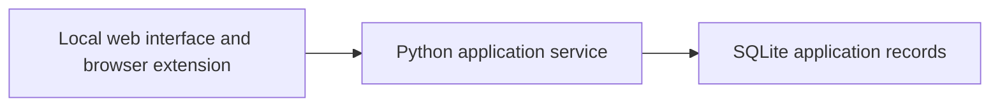

# Job Hunter

## Architecture

A local dashboard for keeping a job posting, company research, documents and application status together.

### Follow one interaction

Open a posting to see its employer and associated documents. Browser activity is recorded against the same job. A submission receipt gives the dashboard evidence to mark an application as submitted.

## APIs and interfaces

| Connection | What crosses it |
| --- | --- |
| Browser extension → local API | The extension sends job-related events to the local Python service. A job ID connects each event with the correct posting. |
| Service → SQLite | The dashboard reads its application history from local tables. Confirmation evidence is stored separately from document preparation. |

### Why it works this way

Viewing a job, preparing a document and receiving a confirmation are different events. Keeping them separate prevents the dashboard from counting an unfinished application as sent.

## Source in this repository

Read [skill_trends.py](skill_trends.py) to see how job descriptions are grouped by the skills they mention, without storing any applications. This is an excerpt from the original app.

[Back to the project index](https://github.com/IT-Yun/IT-Yun)
